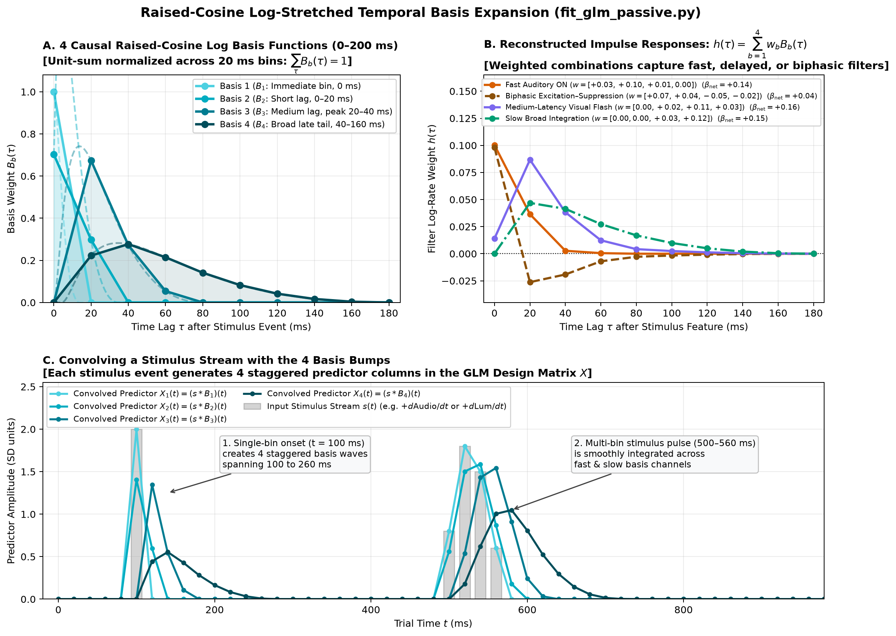
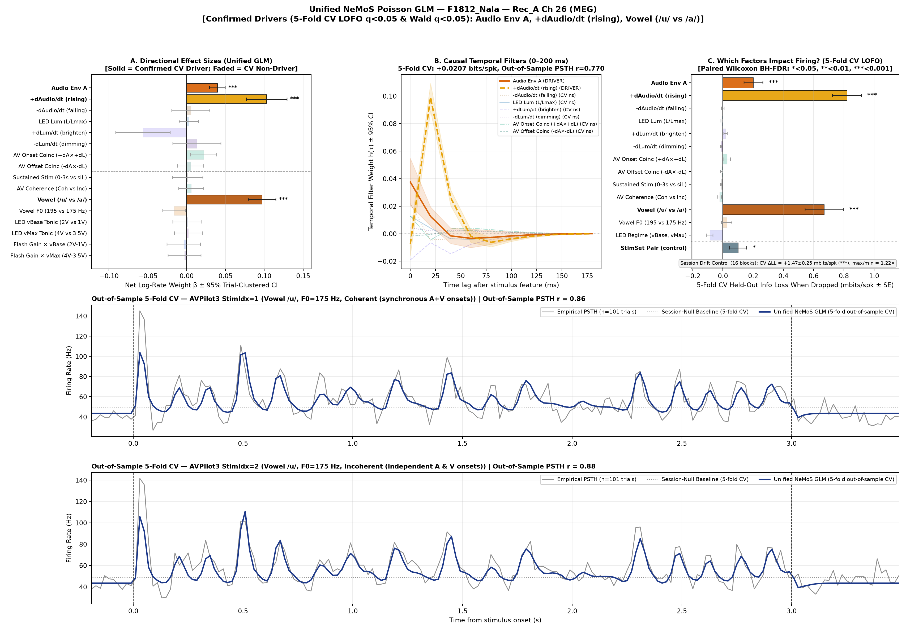
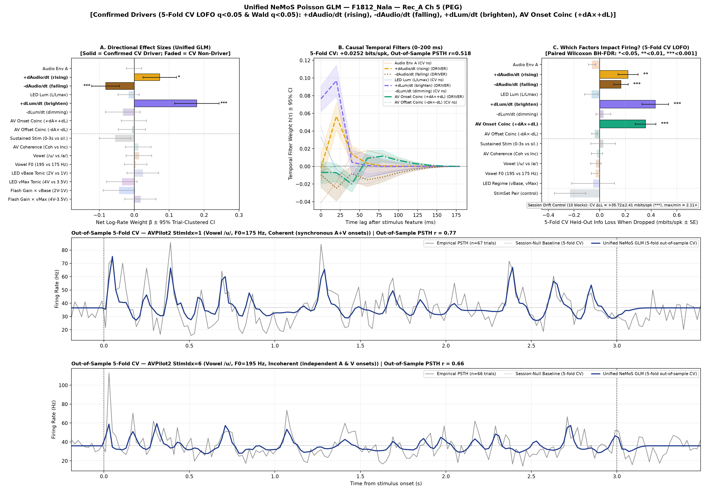

# Passive Audiovisual Neural Coding GLM Pipeline (`AV_passive_nemos`)

A Poisson Generalized Linear Model (GLM) pipeline built on [NeMoS](https://github.com/flatironinstitute/nemos) for characterizing auditory, visual, and multisensory temporal response functions and coherence processing from spike data collected from auditory cortex (primary, secondary and tertiary) and neighboring secondary visual cortex.

---

## Repository Structure

```text
AV_passive_nemos/
├── AV_passive_scripts/          # Analysis and modeling scripts
│   ├── run_pipeline.py          # Unified multi-stage pipeline runner
│   ├── fit_glm_passive.py       # 13-factor causal Poisson GLM with 5-fold CV LOFO
│   ├── plot_channel_diagnostics_auto.py # Session QC and sensory screening
│   ├── extract_sessions.py      # Raw spike and stimulus envelope binning (20 ms)
│   ├── aggregate_glm_results.py # Population-level summary table aggregator
│   ├── plot_basis_explanation.py# Raised-cosine basis visualizer
│   └── pipeline_config.json     # Default pipeline configuration
├── data_tables/                 # Experimental and anatomical metadata
│   ├── Ferret_Side_Chan_Field.csv # Cortical field mapping (MEG, PEG, VC, etc.)
│   ├── Chamber_LED.csv          # PCHIP LED voltage-to-luminance calibration
│   └── Elair_Reps_GLM.csv       # Multi-depth recording rep tables
├── stimuli/                     # Matched audiovisual stimulus envelopes
│   └── AVPilot1_SS.mat ... AVPilot7_SS.mat
├── output/                      # Generated data tables and GLM results
│   ├── diagnostics/             # Channel QC summaries
│   ├── clean_glm/               # Out-of-sample GLM model fits & dashboards
│   └── sense_check_plots/       # Stacked stimulus-envelope sense-check PSTHs
├── docs/images/                 # Methods diagrams and example plots
├── pyproject.toml               # Standard Python project configuration
└── uv.lock                      # Exact dependency lockfile for reproducible builds
```

---

## Environment Setup & Installation

This project adheres to the standard `pyproject.toml` specification (PEP 517 / PEP 621) requiring **Python >= 3.12, < 3.15**. You can set it up using any modern Python package manager:

### Option A: Using `uv` (Recommended — Fastest & Exact Lockfile)
[`uv`](https://github.com/astral-sh/uv) resolves and installs all dependencies in seconds:
```bash
git clone <repo-url>
cd AV_passive_nemos
uv sync
```
To activate the virtual environment:
* **Windows (PowerShell):** `.venv\Scripts\Activate.ps1`
* **macOS / Linux:** `source .venv/bin/activate`

### Option B: Using Standard Python `venv` + `pip`
Any standard Python 3.12+ installation can install directly from `pyproject.toml`:
```bash
git clone <repo-url>
cd AV_passive_nemos

# 1. Create a virtual environment
python -m venv .venv

# 2. Activate it
# On Windows:
.venv\Scripts\activate
# On macOS / Linux:
source .venv/bin/activate

# 3. Install the project and dependencies
pip install -e .
```

### Option C: Using `conda` or `mamba`
If you manage environments with Conda:
```bash
git clone <repo-url>
cd AV_passive_nemos

# 1. Create a Python 3.13 environment
conda create -n av_passive python=3.13 -y
conda activate av_passive

# 2. Install the package dependencies
pip install -e .
```

> **Note on CPU vs. GPU (No WSL2 or CUDA Setup Needed):**  
> This pipeline runs natively on **CPU** across Windows, macOS, and Linux (`~60–90 s` per channel for the full 5-fold CV + 13-factor LOFO evaluation). You do **not** need to configure CUDA or Windows Subsystem for Linux (WSL2) for JAX GPU support to replicate these analyses. For single neuron GLMs run here the performance improvement from JAX GPU support would be marginal.


## GLM Fit Methods: Temporal Basis Functions

To capture continuous neural response dynamics up to 200 ms without overparameterizing the model, every continuous stimulus stream is convolved with a **causal log-stretched raised-cosine basis**:

$$\phi_j(\tau) = \frac{1}{2} \left[ 1 + \cos\left( a \log(\tau + c) - \psi_j \right) \right]$$

This gives high temporal resolution (narrow basis peaks) at early post-stimulus latencies (0–60 ms) where sensory onset transients occur, and broader temporal integration at longer latencies (100–200 ms).



### Model Predictor Decomposition (13 Factors)
1. **Auditory Dynamics (3 groups, 4 basis funcs each, 0–200 ms):**
   * `Audio Env A`: Envelope amplitude level
   * `+dAudio/dt`: Positive half-wave rectified envelope derivative (rising acoustic transients)
   * `-dAudio/dt`: Negative half-wave rectified envelope derivative (acoustic drops / offsets)
2. **Visual Calibrated Dynamics (3 groups, 4 basis funcs each, 0–200 ms):**
   * `LED Lum (L/Lmax)`: Calibrated physical luminance level
   * `+dLum/dt`: Positive derivative (brightening flash transients)
   * `-dLum/dt`: Negative derivative (dimming troughs)
3. **Multisensory Synchrony & Coherence (3 groups):**
   * `AV Onset Coinc (+dA×+dL)` (4 basis funcs, 0–200 ms): Active strictly at synchronous auditory and visual rises. Positive weights reflect super-additive burst facilitation; negative weights reflect sub-additive divisive normalization.
   * `AV Offset Coinc (-dA×-dL)` (4 basis funcs, 0–200 ms): Active strictly at synchronous auditory and visual drops.
   * `AV Coherence (Coh vs Inc)` (1 df): Tonic shift across the [0, 3 s) presentation window testing for sustained rate shifts (e.g., cross-modal LFP phase alignment).
4. **Experimental Contrasts on [0, 3 s):**
   * `Sustained Stim`: Boxcar contrast vs. pre/post silence (absorbs tonic adaptation).
   * `Vowel (/u/ vs /a/)`: Centered spectral contrast.
   * `Vowel F0 (195 vs 175 Hz)`: Fundamental frequency contrast.
   * `LED Regime (vBase, vMax)`: 2×2 luminance baseline/ceiling contrasts including flash-gain interactions.
5. **Nuisance Controls:** StimSet pair deviation contrasts and recording session block drift indicators.

---

## Example Model Outputs

The pipeline uses a **two-stage conservative decision rule**:
* **Primary Gate:** A factor must significantly improve out-of-sample spike prediction on unseen trials in 5-fold cross-validation (ΔLL<sub>CV</sub> > 0, paired Wilcoxon *q*<sub>LOFO</sub> < 0.05 with Benjamini–Hochberg FDR correction).
* **Secondary Gate:** Omnibus trial-clustered Huber-White sandwich Group Wald test (*q*<sub>Wald</sub> < 0.05).

---

### Example 1: Purely Auditory Neuron (Middle Ectosylvian Gyrus, MEG)
*Record: `F1812_Nala` Rec_A Channel 26*

This recording site in primary auditory cortex exhibits sharp acoustic onset sensitivity, rapid envelope tracking, and vowel selectivity (/u/ vs. /a/), while remaining completely unresponsive to visual flashes, LED luminance, and audiovisual synchrony terms (factors faded out in plots to indicate non-significant).



* **Panel A:** Directional effect sizes (β ± 95% trial-clustered CIs). Solid colored bars indicate confirmed biological drivers (*q* < 0.05); faded bars indicate non-drivers.
* **Panel B:** Causal 0–200 ms temporal kernels *h*(τ). Auditory onsets trigger a sharp response peak at 20 ms.
* **Panel C:** Held-out cross-validated information loss (mbits/spike) when each factor is dropped from the model (LOFO).
* **Panels D & E:** Strictly out-of-sample 5-fold CV PSTH predictions (navy blue trace) against empirical peristimulus time histograms (grey trace) across coherent and incoherent presentation streams.

---

### Example 2: Multisensory Tracking Neuron (Posterior Ectosylvian Gyrus, PEG)
*Record: `F1812_Nala` Rec_A Channel 5*

This PEG (secondary auditory cortex) neuron tracks both auditory onsets and visual flashes with high precision. In addition, it displays a confirmed **`AV Onset Coincidence`** term (ΔLL<sub>CV</sub> = +0.36 mbits/spike, *q* = 4.2 × 10<sup>−7</sup>), demonstrating non-linear multisensory burst integration when rises in acoustic and visual stimuli happen together.



---

## Pipeline Architecture: Stages 0, 1, and 2

The pipeline is organized into three sequential, modular stages coordinated by `AV_passive_scripts/run_pipeline.py`:

```text
[Raw Spikes & Stimuli]
         │
         ▼
 ┌───────────────┐
 │   Stage 0     │  extract_sessions.py
 │  Extraction   │  • Bin spikes & envelopes into 20 ms bins ([-0.40s, +3.50s))
 └───────┬───────┘  • PCHIP LED voltage-to-luminance calibration (cd/m²)
         │
         ▼
 ┌───────────────┐
 │   Stage 1     │  plot_channel_diagnostics_auto.py
 │ Quality Ctrl  │  • Trial-level gap QC (<0.50s) & session stability screening
 └───────┬───────┘  • Anatomical field annotation (MEG, PEG, VC) & automated gating
         │
         ▼
 ┌───────────────┐
 │   Stage 2     │  fit_glm_passive.py
 │ Unified GLM   │  • 13-factor 0-200 ms causal log-raised-cosine Poisson GLM
 └───────────────┘  • 5-fold CV LOFO variable selection (Wilcoxon BH-FDR q < 0.05)
                    • Trial-clustered Huber-White sandwich standard errors
```

### Stage 0: Data Extraction (`extract_sessions.py`)
* **Purpose:** Aligns raw per-block spike times (`*_spiketimes.mat`) with synchronized stimulus files (`stimuli/AVPilot*_SS.mat`) into unified analysis arrays.
* **Peristimulus Window & Binning:**
  * Bins spike trains at **20 ms resolution** across a **3.9-second window** ([−0.400, +3.500) s relative to stimulus onset, 195 bins total).
  * The first 10 bins ([−0.400, −0.200) s) serve as causal padding for the 0–200 ms temporal basis filter, leaving **185 evaluated bins** spanning [−0.200, +3.500) s (200 ms pre-stimulus silence, 3000 ms stimulus presentation, and 500 ms post-stimulus silence).
* **Luminance Calibration:**
  * Maps physical LED command voltages to photometric luminance (cd/m²) via shape-preserving monotonic PCHIP spline interpolation from `data_tables/Chamber_LED.csv`.
* **Output:**
  * Compressed NumPy array (`output/{animal}_all_blocks_20ms.npz`) containing `envelopes`, `binned_spikes`, and trial/channel indices.
  * Trial metadata table (`output/{animal}_all_blocks_trials.csv`) with stimulus parameters (`Vowel`, `Pitch`, `Coherence`, `vBase`, `vScale`, `block`).

### Stage 1: Channel Quality Control & Modality Screening (`plot_channel_diagnostics_auto.py`)
* **Purpose:** Screens recording channels across sessions to identify viable single- and multi-unit recording sites and exclude channels affected by silent gaps (wireless dropouts) or severe session instability.
* **Two-Level Quality Control:**
  1. **Trial-Level QC:** Rejects individual trials exhibiting silent gaps > 0.50 s (wireless signal dropouts) or excessive spike artifacts.
  2. **Session-Level QC (Block Screening):** Evaluates firing rate stability across recording blocks. Blocks showing dead recording channels or extreme baseline rate shifts are excluded.
* **Sensory Screening & Cortical Mapping:**
  * Computes dynamic range, signal-to-noise ratio (SNR), and stimulus-response fidelity across auditory and visual streams.
  * Automatically maps channels to anatomical cortical fields (`MEG`, `PEG`, `VC`, `SOM`, `AEG`) via `data_tables/Ferret_Side_Chan_Field.csv`.
  * Outputs an automated `run_glm` decision flag (`1` = pass QC, `0` = exclude) used by Stage 2.
* **Output:**
  * Diagnostics summary CSV (`output/diagnostics/{animal}_{rec}_population_diagnostics_summary.csv`).
  * Per-channel session stability tables (`{unit_id}_diagnostics_session_qc.csv`).
  * Optional 8-panel diagnostic dashboard figures (`--plots`).

### Stage 2: Unified Causal NeMoS Poisson GLM (`fit_glm_passive.py`)
* **Purpose:** Fits a 13-factor causal Poisson GLM with 5-fold cross-validation and Leave-One-Factor-Out (LOFO) variable selection across all channels passing Stage 1 QC.
* **Key Methodology:**
  1. **Single Unified Model:** Avoids running contradictory 1-lag and multi-lag models; all temporal kernels, effect sizes, and predictions derive from one unified fit.
  2. **5-Fold Held-Out Cross-Validation:** Stratified 5-fold cross-validation trains models on 80% of trials and predicts the remaining 20% unseen trials out-of-sample.
  3. **Leave-One-Factor-Out (LOFO) ΔLL:** Drops factor group *g* and measures out-of-sample log-likelihood degradation (in mbits/spike) on held-out trials. A paired Wilcoxon signed-rank test with Benjamini–Hochberg FDR correction (*q*<sub>LOFO</sub> < 0.05) verifies that the factor genuinely drives neural firing.
  4. **Trial-Clustered Huber–White Sandwich Covariance:** Full-dataset refit computes directional effect sizes (β ± 95% CIs), rate multipliers (exp(β)), and omnibus Group Wald tests (*q*<sub>Wald</sub> < 0.05) clustered by trial, correcting for Poisson overdispersion and intra-trial temporal autocorrelation.
* **Output:**
  * 5-panel publication dashboards (`output/clean_glm/{unit_id}_passive_glm_dashboard.png`).
  * Factor-level LOFO stats (`{unit_id}_passive_glm_factors.csv`).
  * Directional contrast effect sizes (`{unit_id}_passive_glm_contrasts.csv`).
  * Population-wide summary tables (`population_units_summary.csv` and `population_factors_long.csv`).

---

## Running the Pipeline

### Automated Batch Pipeline (`run_pipeline.py`)
Run both Stage 1 (automated channel screening & QC) and Stage 2 (unified GLM) across all default sessions:
```bash
python AV_passive_scripts/run_pipeline.py
```

Run for a specific animal and recording stream (hemisphere):
```bash
python AV_passive_scripts/run_pipeline.py --animal F1812_Nala --rec Rec_A
```

Run channels from a particular depth for multi-depth animal (e.g., Eclair Depth 1):
```bash
python AV_passive_scripts/run_pipeline.py --animal F1902_Eclair --depth 1 --rec Rec_A
```

### Fitting Individual Channels (`fit_glm_passive.py`)
Fit the 13-factor GLM directly on specific channels:
```bash
python AV_passive_scripts/fit_glm_passive.py --animal F1812_Nala --rec Rec_A --channels 26 5
```

To also export **editable vector `.pdf` figures** (with selectable TrueType fonts for Adobe Illustrator, Affinity Designer, or Inkscape), pass `--pdf` (saves both `.png` and `.pdf`) or `--fig-format pdf`:
```bash
python AV_passive_scripts/run_pipeline.py --animal F1812_Nala --rec Rec_A --pdf
python AV_passive_scripts/fit_glm_passive.py --animal F1812_Nala --rec Rec_A --channels 26 5 --pdf
```
Output dashboards (`*.png` / `*.pdf`), factor significance summaries (`*_factors.csv`), and directional contrasts (`*_contrasts.csv`) are saved to `output/clean_glm/`.
